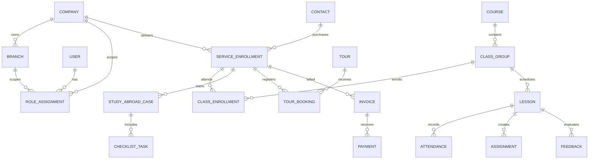

# WE HUBS — ERD (conceptual)

## Production extensions required
- Contact-company sharing grants and legal basis; guardian relationships and consent.
- Resource assignments for teacher/class, counselor/case, tour operator/tour.
- LearningPath/Milestone, AssignmentSubmission, document version, file access log.
- InvoiceLine, payment allocation, credit note, refund, ledger events and exchange rates.
- NotificationOutbox and idempotency keys; approval workflows.
- Composite tenant-scoped foreign keys or triggers verifying company/branch consistency on all child tables.
- Database RLS policies for every sensitive table, with explicit tenant session context and dedicated service roles.

The Prisma schema in this starter is a **domain prototype**, not the complete production schema. Do not migrate it into production without the above constraints and RLS policies.
